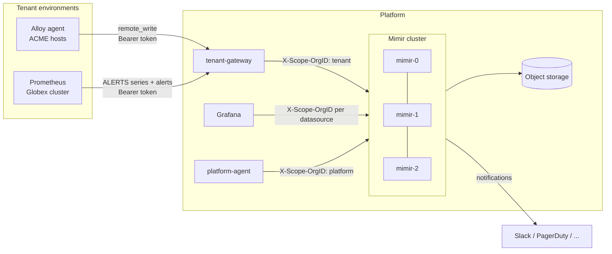
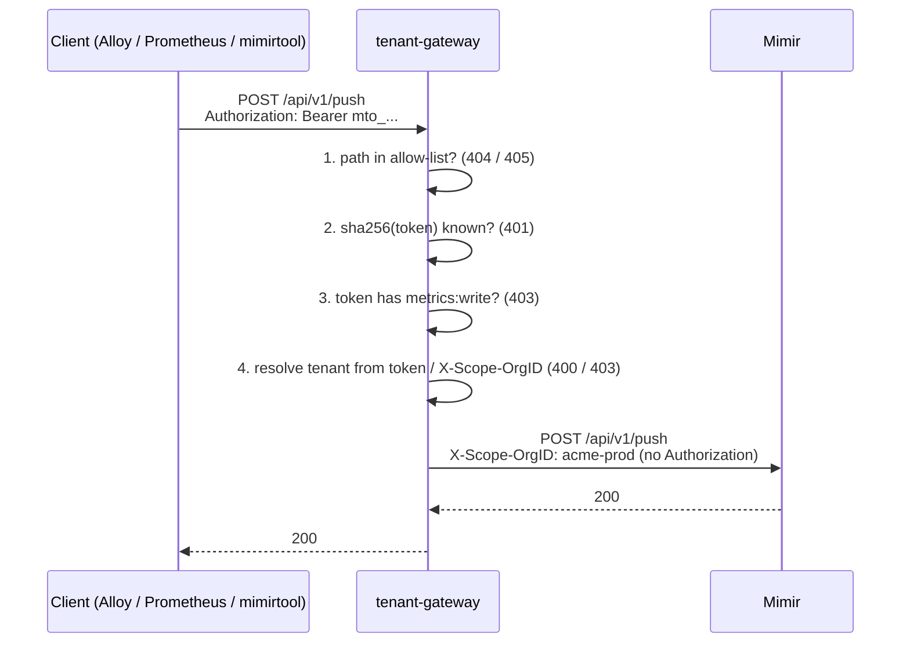
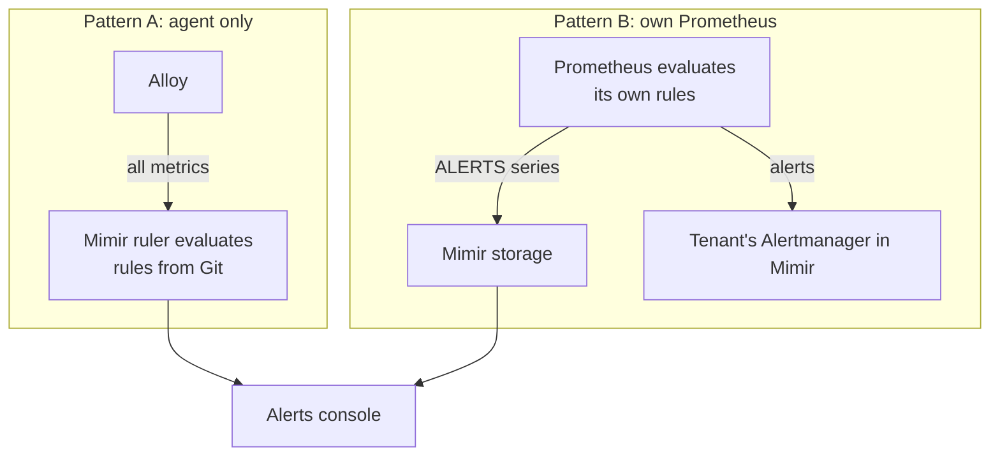

# Architecture

## Components

| Component | Role | Runs as |
|---|---|---|
| **tenant-gateway** | Public entry point. Authenticates every request, decides its tenant and forwards it to Mimir. | Deployment, 2+ replicas |
| **Mimir** | Metrics storage and query engine, ruler (rule evaluation) and Alertmanager, all multi-tenant. Monolithic mode: every replica runs every component. | StatefulSet, 3 replicas |
| **Object storage** | Long-term blocks, rule groups and Alertmanager state. Any S3-compatible bucket. | Managed service (SeaweedFS in the demo) |
| **Grafana** | Dashboards, including the cross-tenant alerts console. One datasource per tenant, plus a federated one. | Deployment |
| **platform-agent** | Grafana Alloy scraping the platform itself into the `platform` tenant. | Deployment |

## Request flow through the gateway

Mimir trusts `X-Scope-OrgID` blindly; it has no authentication of its own. The
whole security model rests on two rules:

1. **Only the gateway is reachable from outside.** Mimir is a ClusterIP
   service and a NetworkPolicy only admits the gateway, Grafana, the
   platform agent and other Mimir replicas.
2. **The gateway never forwards a tenant the token is not bound to.** A
   single-tenant token always runs as its tenant; a request naming a
   different one is refused, not rewritten, so misconfigured clients fail
   loudly.

### Tokens and scopes

Tokens are random 256-bit strings prefixed with `mto_` (so secret scanners
recognise them). The gateway only stores their SHA-256, never the token.

| Scope | Endpoints |
|---|---|
| `metrics:write` | `POST /api/v1/push`, `POST /otlp/v1/metrics` |
| `metrics:read` | `GET/POST /prometheus/api/v1/*` (supports `a\|b` federation) |
| `rules:read`, `rules:write` | `/prometheus/config/v1/rules*` |
| `alerts:write` | `POST /alertmanager/api/v2/alerts` |
| `alerts:read` | `GET /alertmanager/api/v2/*` |
| `alertmanager:config` | `/api/v1/alerts` (per-tenant Alertmanager configuration) |

Everything else, including Mimir's operational endpoints (`/ingester/*`,
`/distributor/*`, `/compactor/*`, `/config`, `/memberlist`), is not routable.
Paths are rejected unless canonical, so `..` cannot escape the allow-list.

A token is bound to one tenant, a list of tenants, or `*` (any tenant,
for operators and CI). Tokens with more than one tenant must say which one
they act on with `X-Scope-OrgID`.

## Two ways to onboard a tenant

| | Pattern A: agent | Pattern B: own Prometheus |
|---|---|---|
| What the tenant runs | Grafana Alloy | Prometheus (e.g. kube-prometheus-stack) |
| What is sent | All metrics | `ALERTS` and `ALERTS_FOR_STATE` only, plus firing alerts |
| Where rules run | Mimir's ruler, rules versioned in this repo | Tenant side |
| Dashboards on the platform | Full | Alerts only |
| Typical case | VMs, small clusters, tenants without monitoring | Clusters that already have a mature Prometheus |

Both end up in the same place: the Mimir ruler also writes `ALERTS` series,
so the alerts console reads one metric for every tenant, whichever pattern
it uses.

## The alerts console

Grafana's "All tenants" datasource sends `X-Scope-OrgID: t1|t2|...` and Mimir
answers with [tenant federation](https://grafana.com/docs/mimir/latest/references/architecture/components/query-frontend/#tenant-federation):
one query across all tenants, each series labelled with `__tenant_id__`.
The datasource is generated from `tenants/tenants.yaml`, so a new tenant
shows up in the console without touching Grafana.

`Watchdog` (always firing, one per tenant) shows that rules are evaluated for
each tenant: by Mimir's ruler for agent tenants, by the tenant's own Prometheus
for the others, whose Watchdog only reaches the console if forwarding works.
That is why tenants with their own Prometheus get no central rule sets. The
console lists tenants whose Watchdog is present. Whether notifications are
delivered is a separate question: route Watchdog through each tenant's
Alertmanager to an external dead man's switch.

## Tenants as code

`tenants/tenants.yaml` is the only place a tenant is declared.
`tenantctl render` (`make generate`) derives from it:

| Output | Consumed by |
|---|---|
| `deploy/kubernetes/base/generated/mimir-runtime.yaml` | Mimir: per-tenant retention and limits, reloaded at runtime |
| `deploy/kubernetes/base/generated/grafana-datasources.yaml` | Grafana: one datasource per tenant + the federated one |
| `rules/sync-plan.tsv` | `scripts/sync-rules.sh`: which rule sets each tenant gets |

Generated files are committed, so every change to a tenant is reviewable as
a diff. CI fails if they drift from `tenants.yaml`.

## Failure modes

| Failure | Impact | Why |
|---|---|---|
| One Mimir replica down | None | Replication factor 3; writes need a quorum of 2 |
| Two Mimir replicas down | Writes fail, recent data partly unavailable | Quorum lost. PDB and topology spread make this unlikely during maintenance |
| One gateway replica down | None | 2+ replicas behind a Service, PDB `minAvailable: 1` |
| Object storage unavailable | Ingestion and recent queries keep working; blocks older than the ingesters' window cannot be read; uploads retry | Ingesters keep ~13h in memory and WAL |
| Grafana down | Dashboards only | Ingestion, rules and notifications do not depend on it |
| Invalid token file pushed | None while the gateways keep running; a gateway that restarts with it cannot start | Running gateways reject it, keep the previous tokens and raise `TenantGatewayConfigRejected`. Check files with `tenantctl check-tokens` before storing them |
| Tenant agent stops | `TenantNoData` fires for that tenant | `absent_over_time(up[15m])` evaluated by the ruler |
| Mimir ruler/Alertmanager broken | No alerts at all | Caught by the Watchdog dead man's switch, which lives outside the platform |
